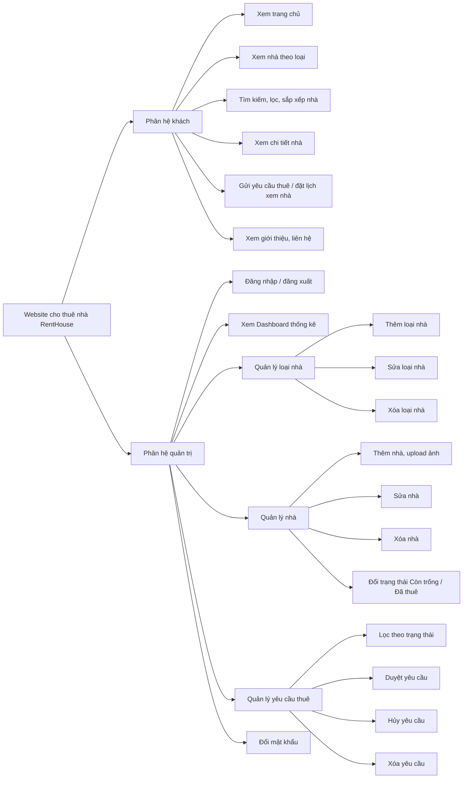
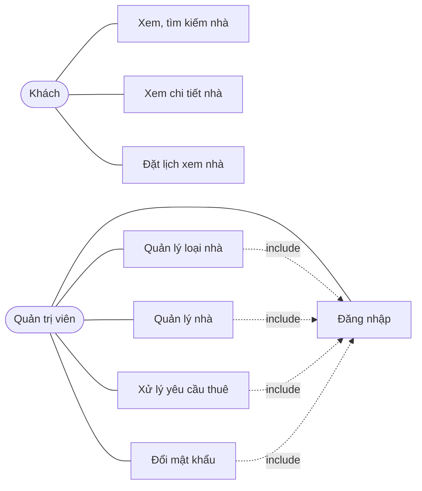
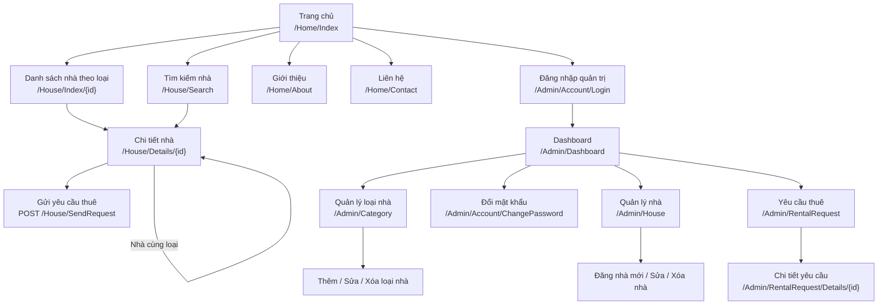

# NỘI DUNG BÁO CÁO ĐỒ ÁN – XÂY DỰNG ỨNG DỤNG WEB CHO THUÊ NHÀ

> Nội dung viết sẵn để chép vào file Word theo mẫu báo cáo. Các phần trong Chương 3 cần hình chụp (Layout, Database Diagram,
> Class Diagram, code...) xem hướng dẫn trong `GHI_CHU_CHUP_HINH.md`. Các sơ đồ trong Chương 2 viết bằng **Mermaid**:
> xem trực tiếp trên GitHub hoặc dán mã vào https://mermaid.live để xuất ảnh PNG chèn vào báo cáo.

---

# CHƯƠNG 1. TỔNG QUAN

## 1.1. Mô tả website

Nhu cầu thuê nhà tại các thành phố lớn như TP. Hồ Chí Minh rất cao, đặc biệt với sinh viên, người lao động từ nơi khác đến và các gia đình trẻ.
Tuy nhiên thông tin cho thuê hiện nay thường nằm rải rác trên mạng xã hội, thiếu thông tin rõ ràng về giá, diện tích, tình trạng còn trống
hay đã cho thuê, khiến người thuê mất nhiều thời gian tìm kiếm và liên hệ.

Đề tài xây dựng website **RentHouse** – ứng dụng web cho thuê nhà, cho phép:

- **Khách truy cập** xem danh sách nhà cho thuê theo từng loại (nhà nguyên căn, phòng trọ, căn hộ chung cư, căn hộ mini), tìm kiếm và lọc theo
  khu vực, khoảng giá, diện tích, số phòng ngủ; xem chi tiết từng căn nhà và gửi **yêu cầu thuê / đặt lịch xem nhà** trực tuyến mà không cần tạo tài khoản.
- **Quản trị viên** đăng nhập vào trang quản trị để quản lý loại nhà, đăng – sửa – xóa tin cho thuê (kèm ảnh), cập nhật tình trạng
  *Còn trống / Đã thuê*, tiếp nhận và xử lý (duyệt, hủy, xóa) các yêu cầu thuê của khách, theo dõi số liệu tổng quan trên Dashboard.

Website được xây dựng bằng ASP.NET MVC 5 trên .NET Framework 4.8, sử dụng Entity Framework 6 để truy cập cơ sở dữ liệu SQL Server
và Bootstrap 5 để xây dựng giao diện thân thiện, hiển thị tốt trên cả máy tính lẫn điện thoại.

## 1.2. Yêu cầu chức năng

### 1.2.1. Chức năng phía khách (không cần đăng nhập)

| STT | Chức năng | Mô tả |
|---|---|---|
| 1 | Trang chủ | Ảnh lớn đầu trang kèm thanh tìm kiếm một hàng (từ khóa, loại nhà, quận, mức giá), mục "Tìm theo loại nhà" (4 thẻ ảnh có số lượng) và lưới "Nhà mới đăng". |
| 2 | Xem nhà theo loại | Hiển thị danh sách nhà theo mã loại; nếu không chọn loại thì hiển thị tất cả. Phân trang 9 nhà/trang. |
| 3 | Tìm kiếm, lọc, sắp xếp | Tìm theo từ khóa (tiêu đề, địa chỉ, quận, mô tả); lọc theo loại nhà, quận/huyện, khoảng giá, diện tích tối thiểu, số phòng ngủ, chỉ nhà còn trống; sắp xếp theo giá tăng/giảm hoặc ngày đăng mới/cũ. |
| 4 | Xem chi tiết nhà | Ảnh, tiêu đề, giá thuê (định dạng 12.000.000 đ/tháng), diện tích, số phòng ngủ, địa chỉ, quận, mô tả, trạng thái, ngày đăng và các nhà cùng loại. |
| 5 | Gửi yêu cầu thuê / đặt lịch xem nhà | Form ngay trong trang chi tiết: họ tên, số điện thoại, email (không bắt buộc), ngày giờ muốn xem, lời nhắn. Nhà "Đã thuê" thì ẩn form. |
| 6 | Giới thiệu, liên hệ | Trang giới thiệu website và trang thông tin liên hệ, câu hỏi thường gặp. |

### 1.2.2. Chức năng phía quản trị (Area Admin, phải đăng nhập)

| STT | Chức năng | Mô tả |
|---|---|---|
| 1 | Đăng nhập, đăng xuất | Đăng nhập bằng tên đăng nhập và mật khẩu, lưu trạng thái bằng Session; mật khẩu được so sánh dưới dạng chuỗi băm SHA256. |
| 2 | Dashboard | Thống kê tổng số nhà, số nhà còn trống / đã thuê, số yêu cầu chờ duyệt, tổng số yêu cầu và 5 yêu cầu mới nhất. |
| 3 | Quản lý loại nhà | Thêm, sửa, xóa loại nhà. Không cho phép xóa loại đang có nhà và hiển thị thông báo lỗi rõ ràng. |
| 4 | Quản lý nhà | Thêm, sửa, xóa nhà; upload ảnh đại diện; đổi trạng thái Còn trống / Đã thuê; tìm kiếm, lọc, phân trang danh sách. |
| 5 | Quản lý yêu cầu thuê | Danh sách yêu cầu lọc theo trạng thái (Chờ duyệt, Đã duyệt, Đã hủy); xem chi tiết, duyệt, hủy, xóa yêu cầu. |
| 6 | Đổi mật khẩu | Nhập mật khẩu hiện tại, mật khẩu mới (tối thiểu 6 ký tự) và nhập lại mật khẩu mới. |

## 1.3. Yêu cầu phi chức năng

- **Giao diện**: tiếng Việt có dấu, gọn và nhất quán (một màu chính navy, một màu nhấn vàng, thang xám trung tính; font Be Vietnam Pro); tương phản chữ đạt chuẩn **WCAG AA**, dùng được bằng bàn phím; **responsive** – hiển thị tốt trên máy tính, máy tính bảng và điện thoại.
- **Dễ sử dụng**: khách không cần đăng ký tài khoản; các thao tác chính (tìm nhà, đặt lịch) chỉ cần vài bước; thông báo lỗi và thông báo thành công rõ ràng.
- **Bảo mật**: trang quản trị phải đăng nhập; chống giả mạo yêu cầu (CSRF), chống SQL Injection, chống XSS; mật khẩu không lưu dạng văn bản gốc;
  chỉ cho phép upload ảnh hợp lệ có dung lượng giới hạn.
- **Toàn vẹn dữ liệu**: dữ liệu được kiểm tra ở cả phía trình duyệt và phía máy chủ; ràng buộc khóa chính, khóa ngoại, CHECK, UNIQUE ở mức cơ sở dữ liệu.
- **Hiệu năng**: chỉ truy vấn dữ liệu của trang hiện tại (phân trang bằng Skip/Take); nạp kèm dữ liệu liên quan bằng `Include` để tránh truy vấn lặp.
- **Khả năng bảo trì**: tổ chức theo mô hình MVC, tách Area quản trị, dùng chung Layout, partial view, các lớp tiện ích (Helpers).
- **Môi trường**: chạy trên Windows với IIS / IIS Express, .NET Framework 4.8, SQL Server 2016 trở lên (bản Express miễn phí).

## 1.4. Cơ sở lý thuyết

### 1.4.1. ASP.NET MVC

**ASP.NET MVC** là framework phát triển ứng dụng web của Microsoft, xây dựng trên nền ASP.NET (.NET Framework) và tổ chức ứng dụng theo
mẫu kiến trúc **MVC (Model – View – Controller)**:

- **Model**: các lớp biểu diễn dữ liệu và nghiệp vụ. Trong đồ án gồm các entity `Category`, `House`, `RentalRequest`, `Account`,
  lớp `RentHouseDBContext` và các ViewModel phục vụ hiển thị / nhập liệu.
- **View**: giao diện hiển thị, viết bằng cú pháp **Razor** (`.cshtml`) – kết hợp HTML với mã C# thông qua ký tự `@`. View nhận dữ liệu
  từ Controller qua Model (strongly-typed view, khai báo bằng `@model`), `ViewBag` hoặc `TempData`.
- **Controller**: lớp kế thừa `Controller`, gồm các **Action** (phương thức public trả về `ActionResult`) nhận request, xử lý, gọi Model và
  trả về kết quả: `View()`, `PartialView()`, `RedirectToAction()`, `HttpNotFound()`, `Content()`...

Luồng xử lý một request: trình duyệt gửi URL → **Routing** phân tích URL theo mẫu `{controller}/{action}/{id}` (khai báo trong `RouteConfig`) →
tạo Controller tương ứng → **Model Binding** tự động gán dữ liệu từ query string / form / route vào tham số của Action →
**Validation** kiểm tra dữ liệu theo DataAnnotations (`[Required]`, `[StringLength]`, `[Range]`, `[RegularExpression]`, `[Compare]`) và lưu
kết quả vào `ModelState` → Action xử lý và trả về View → **View Engine Razor** sinh HTML gửi về trình duyệt.

Một số thành phần khác được sử dụng:

- **Layout page** (`_Layout.cshtml`): khung giao diện dùng chung (menu, footer); nội dung từng trang được chèn tại `@RenderBody()`; các phần
  tùy chọn khai báo bằng `@RenderSection()`. **Partial view** (`_HouseCard`, `_Pager`, `_Alerts`) giúp tái sử dụng một phần giao diện.
- **HTML Helper** (`Html.TextBoxFor`, `Html.ValidationMessageFor`, `Html.BeginForm`, `Html.AntiForgeryToken`, `Url.Action`) sinh mã HTML
  gắn với Model, tự thêm các thuộc tính `data-val-*` để kiểm tra dữ liệu phía client (Unobtrusive Validation).
- **Filter**: đoạn xử lý chạy trước/sau Action như `[HttpPost]`, `[ValidateAntiForgeryToken]`, `[ChildActionOnly]` và filter tự viết
  `AdminAuthorizeAttribute` để kiểm tra đăng nhập.
- **Area**: chia ứng dụng lớn thành các vùng độc lập, mỗi vùng có Controllers/Views riêng. Đồ án dùng Area **Admin** cho trang quản trị.
- **Session, TempData**: Session lưu thông tin đăng nhập của quản trị viên; TempData lưu thông báo hiển thị một lần sau khi chuyển trang
  (mẫu Post/Redirect/Get).

Ưu điểm của ASP.NET MVC: tách biệt rõ giao diện và xử lý, dễ kiểm thử và bảo trì; kiểm soát hoàn toàn HTML sinh ra; URL thân thiện;
hỗ trợ sẵn nhiều cơ chế bảo mật (mã hóa HTML tự động trong Razor, AntiForgeryToken, Request Validation).

### 1.4.2. Entity Framework

**Entity Framework (EF)** là ORM (Object-Relational Mapping) của Microsoft, cho phép lập trình viên làm việc với cơ sở dữ liệu thông qua
các đối tượng C# thay vì viết câu lệnh SQL thủ công. EF tự sinh câu SQL có tham số từ truy vấn **LINQ to Entities**, giúp giảm mã nguồn và
tránh lỗi SQL Injection.

EF hỗ trợ 3 cách tiếp cận:

| Cách tiếp cận | Mô tả |
|---|---|
| Database First | Thiết kế database trước (bằng SQL Server), sau đó tạo các lớp entity ánh xạ tới bảng. |
| Model First | Vẽ mô hình trên designer, EF sinh database từ mô hình. |
| Code First | Viết lớp C# trước, EF (Migrations) sinh database từ code. |

Đồ án sử dụng **Database First**: database `RentHouseDB` được tạo bằng script SQL; các lớp entity và lớp `RentHouseDBContext` được viết tay
khớp đúng tên bảng, tên cột trong script; gọi `Database.SetInitializer<RentHouseDBContext>(null)` để EF **không** tự tạo hay sửa database và
tắt quy ước `PluralizingTableNameConvention` để EF không tự đổi tên bảng sang số nhiều (`Category` → `Categories`).

Các thành phần chính:

- **DbContext**: đại diện cho một phiên làm việc với database, quản lý kết nối (qua chuỗi kết nối `RentHouseDBContext` trong Web.config),
  theo dõi thay đổi của đối tượng và lưu xuống database bằng `SaveChanges()`.
- **DbSet&lt;T&gt;**: đại diện cho một bảng, hỗ trợ truy vấn LINQ (`Where`, `OrderBy`, `Skip`, `Take`, `Count`...) và thêm/xóa (`Add`, `Remove`, `Find`).
- **Navigation property**: thuộc tính liên kết giữa các entity (`House.Category`, `Category.Houses`) tương ứng với khóa ngoại; dữ liệu liên quan
  được nạp kèm bằng `Include()` (eager loading).
- **Fluent API / Data Annotations**: cấu hình ánh xạ (khóa, quan hệ, độ chính xác `decimal(18,0)`, `varchar`, cascade delete) và ràng buộc dữ liệu.

### 1.4.3. SQL Server

**Microsoft SQL Server** là hệ quản trị cơ sở dữ liệu quan hệ (RDBMS) của Microsoft, sử dụng ngôn ngữ **T-SQL**. SQL Server hỗ trợ đầy đủ
các ràng buộc toàn vẹn (PRIMARY KEY, FOREIGN KEY, UNIQUE, CHECK, DEFAULT), chỉ mục, giao tác, phân quyền và tích hợp tốt với .NET.

Đồ án dùng **SQL Server Express** (phiên bản miễn phí) và công cụ **SQL Server Management Studio (SSMS)** để chạy script tạo database,
quản lý dữ liệu và vẽ Database Diagram. Database dùng collation `Vietnamese_CI_AI` để sắp xếp, so sánh tiếng Việt đúng chuẩn và tìm kiếm không
phân biệt hoa thường, không phân biệt dấu thanh (gõ "phong tro" vẫn khớp "Phòng trọ"). Các cột chứa tiếng Việt dùng kiểu `NVARCHAR` (Unicode).

### 1.4.4. Bootstrap

**Bootstrap** là framework CSS/JavaScript mã nguồn mở phổ biến nhất để xây dựng giao diện web **responsive**, ưu tiên thiết bị di động (mobile-first).
Bootstrap 5 không còn phụ thuộc jQuery, cung cấp:

- **Hệ thống lưới (Grid)** 12 cột với các breakpoint `sm`, `md`, `lg`, `xl`, `xxl` giúp bố cục tự co giãn theo kích thước màn hình.
- **Component** dựng sẵn: navbar, dropdown, card, table, form, button, badge, alert, pagination, breadcrumb, accordion, offcanvas...
- **Utility class**: khoảng cách (`m-*`, `p-*`), flexbox (`d-flex`, `gap-*`), màu sắc, chữ, hiển thị theo màn hình (`d-none d-lg-block`).
- **CSS variables** cho phép tùy biến màu, bo góc, khoảng cách mà không phải biên dịch lại Bootstrap. Đồ án gom các biến vào file `Content/theme.css`: màu chính navy `#1F3B66`, màu nhấn vàng `#F2B544` (chỉ cho nút Tìm nhà, Gửi yêu cầu), bo góc 8px/6px, khoảng cách bội số 8px, font Be Vietnam Pro.

Kèm theo là bộ **Bootstrap Icons** (hơn 2.000 biểu tượng dạng font). Cả hai được copy trực tiếp vào thư mục `Content` và `Scripts`
của project (lấy từ npm), không phụ thuộc CDN nên website chạy được cả khi không có Internet.

---

# CHƯƠNG 2. PHÂN TÍCH VÀ THIẾT KẾ

## 2.1. Sơ đồ chức năng

**Sơ đồ ca sử dụng (Use case) rút gọn:**

## 2.2. Sơ đồ trang web (Site map)

## 2.3. Mô tả các nhóm trang

### 2.3.1. Nhóm trang phía khách (dùng `_Layout.cshtml`)

| Trang | URL | Mô tả |
|---|---|---|
| Trang chủ | `/` | Ảnh lớn đầu trang, khung tìm kiếm trắng đè lên mép dưới ảnh với tiêu đề, một câu số liệu (số tin, số quận, số nhà còn trống) và thanh tìm kiếm một hàng; mục "Tìm theo loại nhà" gồm 4 thẻ ảnh có tên và số lượng; mục "Nhà mới đăng" là lưới 6 thẻ nhà còn trống. |
| Danh sách nhà theo loại | `/House/Index/{id}` | Tiêu đề theo loại đang chọn, thanh chữ chọn loại nhà (mục đang xem được gạch chân), bộ lọc cột trái dính khi cuộn (trên điện thoại là nút "Bộ lọc" mở khung trượt), dòng "12 nhà" và ô sắp xếp, lưới thẻ nhà 3 cột / 2 cột / 1 cột theo màn hình, phân trang 9 nhà/trang. Mỗi thẻ: ảnh 4:3, giá đặt trước, tiêu đề tối đa 2 dòng, dòng "80 m² · 3 PN · Bình Thạnh", nhãn "Đã thuê" chỉ khi nhà đã thuê. |
| Tìm kiếm | `/House/Search` | Cùng bố cục với trang danh sách: bộ lọc cột trái (từ khóa, loại, quận, mức giá, diện tích, số phòng ngủ, chỉ nhà còn trống), dòng số kết quả, ô sắp xếp, lưới kết quả có phân trang (giữ nguyên điều kiện lọc khi chuyển trang). |
| Chi tiết nhà | `/House/Details/{id}` | Ảnh lớn, tiêu đề, địa chỉ, dòng thông số nhanh (diện tích, phòng ngủ, quận), bảng thông số dạng danh sách 2 cột, mô tả giữ nguyên xuống dòng; cột phải là hộp đặt lịch dính khi cuộn, giá ở đầu hộp (ẩn form nếu nhà đã thuê); cuối trang là 4 nhà cùng loại. |
| Giới thiệu, Liên hệ | `/Home/About`, `/Home/Contact` | Giới thiệu ngắn về website kèm số liệu hiện tại; thông tin liên hệ, 3 bước đặt lịch xem nhà, câu hỏi thường gặp. |
| Trang lỗi | `/Error/NotFound`, `/Error/ServerError` | Thông báo thân thiện khi không tìm thấy trang (404) hoặc hệ thống gặp lỗi (500). |

### 2.3.2. Nhóm trang quản trị (Area Admin, dùng `_AdminLayout.cshtml`)

| Trang | URL | Mô tả |
|---|---|---|
| Đăng nhập | `/Admin/Account/Login` | Form đăng nhập riêng (không dùng layout), có kiểm tra dữ liệu và thông báo sai tài khoản. |
| Dashboard (Tổng quan) | `/Admin` | 3 ô số liệu (tổng số nhà, nhà còn trống, yêu cầu chờ duyệt) và bảng 5 yêu cầu mới nhất, nút "Đăng nhà mới". |
| Loại nhà | `/Admin/Category` | Bảng loại nhà kèm số nhà; trang thêm, sửa, xác nhận xóa. |
| Nhà cho thuê | `/Admin/House` | Bảng nhà có ảnh thu nhỏ, lọc theo từ khóa / loại / trạng thái, phân trang 10 dòng; nút đổi trạng thái nhanh; trang thêm/sửa có upload và xem trước ảnh; trang xác nhận xóa. |
| Yêu cầu thuê | `/Admin/RentalRequest` | Tab lọc theo trạng thái kèm số lượng, bảng yêu cầu có nút duyệt / hủy / xóa / chi tiết; trang chi tiết yêu cầu. |
| Đổi mật khẩu | `/Admin/Account/ChangePassword` | Form đổi mật khẩu. |

Giao diện quản trị có menu bên trái cố định trên máy tính và chuyển thành menu trượt (offcanvas) trên điện thoại.

---

# CHƯƠNG 3. XÂY DỰNG WEBSITE (các mục viết sẵn)

## 3.2.2. Mô tả các bảng dữ liệu

Cơ sở dữ liệu **RentHouseDB** gồm 4 bảng. Quan hệ: **Category (1) – (n) House**, **House (1) – (n) RentalRequest**; bảng **Account** độc lập.

### Bảng Category – Loại nhà

| Tên cột | Kiểu dữ liệu | Mô tả | Ghi chú |
|---|---|---|---|
| Id | int | Mã loại nhà | Khóa chính (`PK_Category`), tự tăng IDENTITY(1,1) |
| CatName | nvarchar(100) | Tên loại nhà | NOT NULL, duy nhất (`UQ_Category_CatName`) |

### Bảng House – Nhà cho thuê

| Tên cột | Kiểu dữ liệu | Mô tả | Ghi chú |
|---|---|---|---|
| HouseId | int | Mã nhà | Khóa chính (`PK_House`), tự tăng |
| Title | nvarchar(200) | Tiêu đề tin cho thuê | NOT NULL |
| Address | nvarchar(255) | Địa chỉ (số nhà, đường, phường) | NOT NULL |
| District | nvarchar(50) | Quận / huyện | NOT NULL |
| Price | decimal(18,0) | Giá thuê mỗi tháng (đồng) | NOT NULL, `CK_House_Price`: > 0 |
| Acreage | float | Diện tích (m²) | NOT NULL, `CK_House_Acreage`: > 0 |
| Bedrooms | int | Số phòng ngủ | NOT NULL, `CK_House_Bedrooms`: >= 0 |
| Description | nvarchar(max) | Mô tả chi tiết | Cho phép NULL |
| Image | nvarchar(255) | Tên file ảnh trong `Content/images/houses` | Cho phép NULL (hiển thị ảnh placeholder) |
| Status | nvarchar(20) | Trạng thái | NOT NULL, mặc định N'Còn trống' (`DF_House_Status`), chỉ nhận 'Còn trống' / 'Đã thuê' (`CK_House_Status`) |
| PostedDate | datetime | Ngày đăng | NOT NULL, mặc định GETDATE() (`DF_House_PostedDate`) |
| CatId | int | Mã loại nhà | NOT NULL, khóa ngoại `FK_House_Category` → Category(Id); có chỉ mục `IX_House_CatId` |

### Bảng RentalRequest – Yêu cầu thuê / đặt lịch xem nhà

| Tên cột | Kiểu dữ liệu | Mô tả | Ghi chú |
|---|---|---|---|
| RequestId | int | Mã yêu cầu | Khóa chính (`PK_RentalRequest`), tự tăng |
| HouseId | int | Mã nhà khách muốn thuê | NOT NULL, khóa ngoại `FK_RentalRequest_House` → House(HouseId), **ON DELETE CASCADE** (xóa nhà thì xóa luôn yêu cầu); chỉ mục `IX_RentalRequest_HouseId` |
| CustomerName | nvarchar(100) | Họ tên khách hàng | NOT NULL |
| CustomerPhone | varchar(15) | Số điện thoại | NOT NULL |
| CustomerEmail | nvarchar(100) | Email khách hàng | Cho phép NULL |
| ViewingDate | datetime | Ngày giờ khách muốn xem nhà | NOT NULL |
| Note | nvarchar(500) | Lời nhắn của khách | Cho phép NULL |
| Status | nvarchar(20) | Trạng thái xử lý | NOT NULL, mặc định N'Chờ duyệt', chỉ nhận 'Chờ duyệt' / 'Đã duyệt' / 'Đã hủy' (`CK_RentalRequest_Status`) |
| CreatedDate | datetime | Thời điểm gửi yêu cầu | NOT NULL, mặc định GETDATE() |

### Bảng Account – Tài khoản quản trị

| Tên cột | Kiểu dữ liệu | Mô tả | Ghi chú |
|---|---|---|---|
| AccountId | int | Mã tài khoản | Khóa chính (`PK_Account`), tự tăng |
| Username | nvarchar(50) | Tên đăng nhập | NOT NULL, duy nhất (`UQ_Account_Username`) |
| Password | varchar(64) | Mật khẩu đã băm SHA256 (64 ký tự hex) | NOT NULL, không lưu mật khẩu gốc |
| FullName | nvarchar(100) | Họ tên quản trị viên | NOT NULL |

**Dữ liệu mẫu**: 4 loại nhà (Nhà nguyên căn, Phòng trọ, Căn hộ chung cư, Căn hộ mini), 12 nhà tại các quận Bình Thạnh, Quận 1, Quận 3,
Quận 7, Quận 10, Gò Vấp, Tân Bình, Phú Nhuận, TP. Thủ Đức với giá từ 2.500.000 đ đến 35.000.000 đ/tháng, 5 yêu cầu thuê ở đủ 3 trạng thái và tài khoản `admin` / `123456`.

## 3.3. Mô tả các Action

### 3.3.1. Phía khách

| Controller | Action | Phương thức | URL | Mô tả |
|---|---|---|---|---|
| HomeController | Index() | GET | `/` | Lấy 6 nhà còn trống mới nhất, danh sách loại nhà kèm số lượng và các số liệu thống kê, trả về trang chủ. |
| HomeController | About() | GET | `/Home/About` | Trang giới thiệu, hiển thị số nhà, số loại nhà, số yêu cầu. |
| HomeController | Contact() | GET | `/Home/Contact` | Trang liên hệ. |
| HomeController | CategoryMenu() | Child action | (gọi trong `_Layout`) | `[ChildActionOnly]` – trả về partial menu loại nhà trên thanh điều hướng. |
| HouseController | Index(int? id, int page = 1) | GET | `/House/Index/{id}?page=n` | `id` là mã loại nhà; `id` null thì lấy tất cả. Trả về 404 nếu mã loại không tồn tại. Sắp xếp theo ngày đăng giảm dần, phân trang 9 nhà/trang bằng `PagedList<House>`. |
| HouseController | Search(HouseSearchViewModel filter) | GET | `/House/Search?keyword=&catId=&district=&price=&minAcreage=&bedrooms=&onlyAvailable=&sort=&page=` | Ghép dần các điều kiện `Where` theo bộ lọc, sắp xếp theo `sort` (moi-nhat, cu-nhat, gia-tang, gia-giam), phân trang 9 nhà/trang. |
| HouseController | Details(int id) | GET | `/House/Details/{id}` | Lấy nhà kèm loại (`Include`), 4 nhà cùng loại, chuẩn bị form đặt lịch; 404 nếu không tìm thấy. |
| HouseController | SendRequest(RentalRequestFormModel form) | POST | `/House/SendRequest` | `[ValidateAntiForgeryToken]`. Kiểm tra nhà tồn tại và còn trống, ngày xem phải sau hiện tại và trong 3 tháng, dữ liệu hợp lệ; lưu `RentalRequest` trạng thái "Chờ duyệt"; chuyển hướng về trang chi tiết kèm thông báo (Post/Redirect/Get). Nếu lỗi thì hiển thị lại form kèm thông báo. |
| ErrorController | NotFound() | GET | `/Error/NotFound` | Trang lỗi 404 thân thiện. |
| ErrorController | ServerError() | GET | `/Error/ServerError` | Trang lỗi 500 thân thiện; nhận diện lỗi nhập ký tự nguy hiểm, file quá lớn; chỉ hiện chi tiết kỹ thuật khi chạy trên localhost. |

### 3.3.2. Phía quản trị (Area Admin)

| Controller | Action | Phương thức | URL | Mô tả |
|---|---|---|---|---|
| AccountController | Login(string returnUrl) | GET | `/Admin/Account/Login` | `[AllowAnonymous]`. Hiển thị form đăng nhập (đã đăng nhập thì chuyển về Dashboard). |
| AccountController | Login(LoginViewModel model) | POST | `/Admin/Account/Login` | `[AllowAnonymous]`, `[ValidateAntiForgeryToken]`. Tìm tài khoản theo Username, so sánh SHA256 của mật khẩu; đúng thì lưu `AdminId`, `AdminUsername`, `AdminFullName` vào Session và chuyển tới `returnUrl` (chỉ URL nội bộ) hoặc Dashboard. |
| AccountController | Logout() | POST | `/Admin/Account/Logout` | Xóa Session, chuyển về trang đăng nhập. |
| AccountController | ChangePassword() | GET / POST | `/Admin/Account/ChangePassword` | Kiểm tra mật khẩu hiện tại, mật khẩu mới ≥ 6 ký tự, khác mật khẩu cũ, nhập lại khớp; lưu chuỗi băm mới. |
| DashboardController | Index() | GET | `/Admin` | Đếm tổng số nhà, nhà còn trống, đã thuê, số loại, yêu cầu chờ duyệt, tổng yêu cầu; lấy 5 yêu cầu mới nhất. |
| DashboardController | PendingCount() | Child action | (gọi trong `_AdminLayout`) | Trả về số yêu cầu chờ duyệt hiển thị trên menu. |
| CategoryController | Index() | GET | `/Admin/Category` | Danh sách loại nhà kèm số nhà, số nhà còn trống. |
| CategoryController | Create() | GET / POST | `/Admin/Category/Create` | Thêm loại nhà, kiểm tra tên không trùng; POST dùng `[Bind(Include = "CatName")]`. |
| CategoryController | Edit(int id) | GET / POST | `/Admin/Category/Edit/{id}` | Sửa tên loại nhà, kiểm tra trùng tên. |
| CategoryController | Delete(int id) / DeleteConfirmed(int id) | GET / POST | `/Admin/Category/Delete/{id}` | Trang xác nhận; nếu loại đang có nhà thì **không cho xóa** và báo rõ số nhà. |
| HouseController | Index(string keyword, int? catId, string status, int page = 1) | GET | `/Admin/House` | Danh sách nhà có lọc và phân trang 10 dòng. |
| HouseController | Create() | GET / POST | `/Admin/House/Create` | Thêm nhà bằng `HouseFormViewModel`; kiểm tra loại nhà, quận, trạng thái, file ảnh; lưu ảnh với tên GUID. |
| HouseController | Edit(int id) | GET / POST | `/Admin/House/Edit/{id}` | Sửa nhà; nếu chọn ảnh mới thì lưu ảnh mới và xóa ảnh cũ đã upload. |
| HouseController | Delete(int id) / DeleteConfirmed(int id) | GET / POST | `/Admin/House/Delete/{id}` | Trang xác nhận (báo số yêu cầu sẽ bị xóa theo); xóa nhà, các yêu cầu bị xóa theo nhờ ON DELETE CASCADE, xóa file ảnh. |
| HouseController | ToggleStatus(int id, string returnUrl) | POST | `/Admin/House/ToggleStatus/{id}` | Đổi trạng thái Còn trống ⇄ Đã thuê rồi quay lại trang trước. |
| RentalRequestController | Index(string status, int page = 1) | GET | `/Admin/RentalRequest?status=...` | Danh sách yêu cầu lọc theo trạng thái, đếm số yêu cầu mỗi trạng thái (GroupBy), phân trang. |
| RentalRequestController | Details(int id) | GET | `/Admin/RentalRequest/Details/{id}` | Chi tiết yêu cầu và thông tin nhà. |
| RentalRequestController | Approve(int id) / Cancel(int id) | POST | `/Admin/RentalRequest/Approve/{id}`, `/Cancel/{id}` | Chuyển trạng thái sang "Đã duyệt" / "Đã hủy". |
| RentalRequestController | Delete(int id) | POST | `/Admin/RentalRequest/Delete/{id}` | Xóa yêu cầu (có hộp xác nhận). |

## 3.4. Bảo mật

| Nguy cơ | Giải pháp trong đồ án |
|---|---|
| Truy cập trái phép trang quản trị | Filter `AdminAuthorizeAttribute` (implements `IAuthorizationFilter`) đăng ký **toàn cục** trong `FilterConfig`: mọi controller thuộc Area Admin (nhận diện theo area và namespace) đều yêu cầu `Session["AdminId"]`; chỉ action đăng nhập có `[AllowAnonymous]`. Chưa đăng nhập thì chuyển tới trang đăng nhập kèm `returnUrl`. Route mặc định đặt `UseNamespaceFallback = false` nên không gọi được controller Admin qua URL ngoài `/Admin`. |
| Lộ mật khẩu | Mật khẩu lưu dạng băm **SHA256** (64 ký tự hex), so sánh chuỗi băm với thời gian không đổi; đổi mật khẩu phải nhập đúng mật khẩu cũ. Chuỗi kết nối dùng Windows Authentication, không chứa mật khẩu. |
| CSRF (giả mạo yêu cầu) | `@Html.AntiForgeryToken()` trong **mọi** form POST và `[ValidateAntiForgeryToken]` trên **mọi** action POST (kể cả đăng xuất, đổi trạng thái, duyệt/hủy/xóa). |
| SQL Injection | Mọi truy vấn đi qua **Entity Framework / LINQ**, EF sinh câu SQL có tham số (`@p__linq__0`); không ghép chuỗi SQL. |
| XSS | Razor tự mã hóa HTML khi xuất `@...`; **không dùng `Html.Raw`** với dữ liệu người dùng nhập (mô tả giữ xuống dòng bằng CSS `white-space: pre-line`); ASP.NET Request Validation chặn dữ liệu chứa thẻ HTML và hiển thị trang báo lỗi thân thiện. |
| Overposting (gửi thêm trường trái phép) | Dùng ViewModel riêng (`RentalRequestFormModel`, `HouseFormViewModel`) hoặc `[Bind(Include = ...)]`; các trường như Status, CreatedDate do server gán. |
| Dữ liệu không hợp lệ | Kiểm tra **2 lớp**: client (jQuery Validation Unobtrusive) và server (DataAnnotations + kiểm tra bổ sung: ngày xem trong tương lai, quận/trạng thái/loại hợp lệ, tên loại không trùng); ràng buộc CHECK, UNIQUE, FOREIGN KEY trong database. |
| Upload file độc hại | Chỉ nhận `.jpg/.jpeg/.png/.webp`, dung lượng < 2MB (kiểm tra ở cả trình duyệt và server), kiểm tra **chữ ký đầu file** (magic bytes) để chặn file đổi đuôi, **đổi tên ngẫu nhiên** bằng GUID, chỉ lưu vào `Content/images/houses`; giới hạn kích thước request trong Web.config. |
| Open Redirect | `returnUrl` chỉ được dùng khi `Url.IsLocalUrl(returnUrl)` trả về true. |
| Lộ thông tin hệ thống | Trang lỗi 404/500 thân thiện (xử lý trong `Application_Error` và `httpErrors`), chi tiết lỗi chỉ hiện khi truy cập từ localhost; ẩn header `X-AspNetMvc-Version`, `X-Powered-By`, phiên bản ASP.NET. |
| Clickjacking, MIME sniffing | Header `X-Frame-Options: SAMEORIGIN`, `X-Content-Type-Options: nosniff`; cookie `HttpOnly`. |

## 3.5. Kiểm tra và xuất bản

### 3.5.1. Kiểm tra (test case)

> Cột **Kết quả** để trống: chạy thử từng trường hợp trên máy của bạn rồi điền "Đạt" / "Không đạt".

| STT | Chức năng | Các bước thực hiện | Dữ liệu thử | Kết quả mong đợi | Kết quả |
|---|---|---|---|---|---|
| 1 | Trang chủ | Mở `http://localhost:50780/` | – | Hiện ảnh đầu trang, thanh tìm kiếm, 4 loại nhà, 6 nhà còn trống mới đăng; giá dạng `6.500.000 đ/tháng` | |
| 2 | Xem nhà theo loại | Menu Nhà cho thuê → Căn hộ mini | id = 4 | URL `/House/Index/4`, chỉ hiện nhà loại Căn hộ mini | |
| 3 | Phân trang | Mở `/House`, bấm trang 2 | 12 nhà | Trang 1 có 9 nhà, trang 2 có 3 nhà | |
| 4 | Loại nhà không tồn tại | Mở `/House/Index/999` | id = 999 | Hiện trang lỗi 404 thân thiện | |
| 5 | Tìm kiếm không dấu | Ô tìm kiếm nhập "phong tro" | keyword | Tìm ra 3 nhà "Phòng trọ" (collation Vietnamese_CI_AI không phân biệt dấu thanh) | |
| 6 | Lọc và sắp xếp | Tìm kiếm: Khoảng giá "Từ 5 - 10 triệu", sắp xếp "Giá thấp đến cao" | – | Chỉ hiện nhà giá 5–10 triệu, giá tăng dần, giữ điều kiện lọc khi chuyển trang | |
| 7 | Chi tiết nhà | Bấm vào một nhà | `/House/Details/10` | Hiện đầy đủ thông tin, form đặt lịch, 4 nhà cùng loại | |
| 8 | Đặt lịch – bỏ trống | Bấm Gửi yêu cầu khi chưa nhập gì | – | Báo lỗi đỏ "Vui lòng nhập họ tên", "Vui lòng nhập số điện thoại", "Vui lòng chọn ngày giờ..." (không gửi lên server) | |
| 9 | Đặt lịch – SĐT sai | Nhập SĐT "123" | 123 | Báo "Số điện thoại không hợp lệ (VD: 0901234567)" | |
| 10 | Đặt lịch – ngày quá khứ | Chọn ngày hôm qua | – | Báo "Ngày giờ xem nhà phải sau thời điểm hiện tại" | |
| 11 | Đặt lịch – hợp lệ | Nhập đủ thông tin hợp lệ, bấm Gửi | Nguyễn Văn B, 0909123456, ngày mai 9:00 | Thông báo gửi thành công; Admin thấy yêu cầu mới trạng thái "Chờ duyệt" | |
| 12 | Nhà đã thuê | Mở `/House/Details/3` | – | Không có form, hiện thông báo "Nhà này đã được cho thuê" | |
| 13 | Chặn XSS | Đặt lịch với lời nhắn `` | – | Không chạy script; hiện trang thông báo dữ liệu chứa ký tự không được phép | |
| 14 | Chặn truy cập Admin | Chưa đăng nhập, mở `/Admin/House` | – | Chuyển tới trang đăng nhập, đăng nhập xong quay lại `/Admin/House` | |
| 15 | Đăng nhập sai | admin / 111111 | – | Báo "Tên đăng nhập hoặc mật khẩu không đúng." | |
| 16 | Đăng nhập đúng | admin / 123456 | – | Vào Dashboard, hiện số liệu thống kê và 5 yêu cầu mới nhất | |
| 17 | Thêm loại nhà trùng tên | Loại nhà → Thêm "Phòng trọ" | Phòng trọ | Báo "Tên loại nhà đã tồn tại." | |
| 18 | Xóa loại đang có nhà | Loại nhà → Xóa "Phòng trọ" | – | Không xóa được, báo rõ "đang có 3 nhà thuộc loại này" | |
| 19 | Thêm nhà có ảnh | Nhà cho thuê → Đăng nhà mới, chọn ảnh JPG < 2MB | – | Thêm thành công, ảnh lưu trong `Content/images/houses` với tên ngẫu nhiên, hiện trên trang khách | |
| 20 | Upload file sai | Chọn file `.pdf` hoặc ảnh > 2MB | – | Báo "Chỉ chấp nhận ảnh định dạng JPG, PNG hoặc WEBP." / "Dung lượng ảnh phải nhỏ hơn 2MB." | |
| 21 | Đổi trạng thái nhà | Bấm nhãn trạng thái của một nhà | – | Còn trống ⇄ Đã thuê; trang khách cập nhật, form đặt lịch ẩn/hiện tương ứng | |
| 22 | Xóa nhà | Xóa một nhà có yêu cầu thuê | – | Nhà và các yêu cầu của nhà đó bị xóa (ON DELETE CASCADE) | |
| 23 | Lọc yêu cầu | Yêu cầu thuê → tab "Chờ duyệt" | – | Chỉ hiện yêu cầu chờ duyệt, số lượng trên tab đúng | |
| 24 | Duyệt / hủy / xóa yêu cầu | Bấm các nút tương ứng | – | Trạng thái đổi đúng, có thông báo; xóa có hộp xác nhận | |
| 25 | Đổi mật khẩu | Mật khẩu cũ sai / nhập lại không khớp / hợp lệ | – | Báo lỗi tương ứng; hợp lệ thì đổi thành công, đăng nhập lại bằng mật khẩu mới | |
| 26 | Đăng xuất | Bấm Đăng xuất | – | Về trang đăng nhập, không vào lại được `/Admin` | |
| 27 | Trang 404 | Mở `/abc/xyz` | – | Hiện trang 404 thân thiện | |
| 28 | Responsive | Thu nhỏ trình duyệt / F12 → chế độ điện thoại | – | Menu thu gọn thành nút ☰, bộ lọc thành nút "Bộ lọc" mở khung trượt, lưới nhà 1 cột, menu admin trượt ra | |

### 3.5.2. Xuất bản (Publish) lên IIS

1. **Chuẩn bị máy chủ**: Windows có bật IIS (*Control Panel → Programs → Turn Windows features on or off → Internet Information Services*,
   tích thêm *World Wide Web Services → Application Development Features → ASP.NET 4.8*), cài SQL Server và chạy script `RentHouseDB.sql`.
2. **Publish từ Visual Studio**: chuột phải project `RentHouseMVC` → **Publish** → **Folder** → chọn thư mục, ví dụ `D:\Publish\RentHouse` →
   cấu hình **Release** → **Publish**. Kết quả gồm các file `.cshtml`, `Content`, `Scripts`, `bin` (đã có `bin\roslyn`), `Web.config`.
   (File `Web.Release.config` tự tắt `debug="true"` khi publish.)
3. **Tạo website trong IIS**: mở *IIS Manager* → *Sites* → **Add Website**: đặt tên `RentHouse`, *Physical path* là thư mục publish, chọn port (ví dụ 8080).
   Application Pool dùng **.NET CLR v4.0**, *Managed pipeline mode*: **Integrated**.
4. **Quyền truy cập**:
   - Cấp quyền **Modify** cho tài khoản `IIS AppPool\RentHouse` trên thư mục `Content\images\houses` để upload ảnh được.
   - Vì chuỗi kết nối dùng *Integrated Security*, cần tạo login cho `IIS AppPool\RentHouse` trong SQL Server
     (SSMS → Security → Logins → New Login) và cấp quyền `db_datareader`, `db_datawriter` trên database `RentHouseDB`;
     hoặc đổi chuỗi kết nối sang tài khoản SQL (`User ID=...;Password=...`) – khi đó **không** đưa file cấu hình chứa mật khẩu lên GitHub.
5. Truy cập `http://localhost:8080/` để kiểm tra. Nếu website được đặt trong thư mục con (Virtual Application) thì sửa đường dẫn trong
   phần `<httpErrors>` của Web.config cho đúng (ví dụ `/RentHouse/Error/NotFound`).
6. Có thể đưa lên hosting hỗ trợ **ASP.NET 4.8 + SQL Server** bằng cách upload thư mục publish (FTP / Web Deploy), chạy script SQL trên
   database của hosting và sửa chuỗi kết nối trong `Web.config` theo thông tin hosting cung cấp; nên bật **HTTPS** khi chạy thật.

---

# CHƯƠNG 4. KẾT LUẬN

## 4.1. Kết quả đạt được

- Xây dựng hoàn chỉnh website cho thuê nhà **RentHouse** theo mô hình **ASP.NET MVC 5**, gồm phân hệ khách và phân hệ quản trị (Area Admin),
  đáp ứng đầy đủ các yêu cầu chức năng đã đặt ra: xem nhà theo loại có phân trang, tìm kiếm – lọc – sắp xếp đa điều kiện, xem chi tiết,
  đặt lịch xem nhà; quản lý loại nhà, nhà (kèm upload ảnh), yêu cầu thuê, dashboard thống kê, đổi mật khẩu.
- Thiết kế cơ sở dữ liệu **RentHouseDB** gồm 4 bảng chuẩn hóa với đầy đủ ràng buộc được đặt tên rõ ràng; áp dụng **Entity Framework 6**
  theo hướng **Database First** với các lớp entity và DbContext viết tay khớp chính xác với script.
- Giao diện tiếng Việt gọn gàng theo một hệ thống thiết kế thống nhất (màu, font, khoảng cách, bo góc định nghĩa bằng biến CSS), **responsive** nhờ Bootstrap 5, kiểm tra ở các bề rộng 375px, 768px, 1280px và đạt chuẩn tương phản WCAG AA; định dạng giá tiền theo kiểu Việt Nam; ảnh "Chưa có ảnh" cho nhà chưa có ảnh.
- Áp dụng nhiều biện pháp **bảo mật**: filter kiểm tra đăng nhập, băm mật khẩu SHA256, chống CSRF, SQL Injection, XSS, overposting,
  kiểm tra file upload, trang lỗi thân thiện.
- Nắm vững quy trình xây dựng một ứng dụng web: phân tích yêu cầu, thiết kế cơ sở dữ liệu, lập trình theo MVC, kiểm thử và triển khai.

## 4.2. Hạn chế

- Ảnh nhà mẫu là ảnh minh họa miễn phí bản quyền từ Pexels, không phải ảnh chụp thật của từng căn nhà cho thuê.
- Mỗi nhà chỉ có **một ảnh đại diện**, chưa có thư viện nhiều ảnh, video hay bản đồ vị trí.
- Khách chưa có tài khoản riêng nên không theo dõi được lịch sử yêu cầu, chưa có chức năng lưu nhà yêu thích.
- Chưa gửi **email / SMS** thông báo khi yêu cầu được duyệt hoặc hủy.
- Chỉ có một vai trò quản trị; chưa phân quyền nhiều cấp (chủ nhà, nhân viên, quản trị viên).
- Đăng nhập dùng Session đơn giản, chưa có giới hạn số lần đăng nhập sai, chưa dùng thuật toán băm có salt chuyên dụng (PBKDF2/BCrypt).
- Danh sách quận/huyện cố định theo địa giới cũ của TP.HCM; tìm kiếm chưa hỗ trợ tìm theo bán kính / bản đồ.
- Chưa có kiểm thử tự động (unit test) và chưa triển khai HTTPS.

## 4.3. Hướng mở rộng

- Cho phép **chủ nhà đăng ký tài khoản** và tự đăng tin; quản trị viên duyệt tin trước khi hiển thị; phân quyền bằng ASP.NET Identity.
- Thêm **nhiều ảnh cho mỗi nhà** (bảng `HouseImage`), tích hợp **Google Maps** hiển thị vị trí và tìm nhà gần trường học/nơi làm việc.
- Gửi **email / SMS / Zalo** xác nhận lịch hẹn; nhắc lịch xem nhà; khách đánh giá, bình luận sau khi xem.
- Thêm tiện ích (máy lạnh, chỗ để xe, thú cưng...) vào bộ lọc; gợi ý nhà tương tự; lưu nhà yêu thích.
- Thống kê nâng cao bằng biểu đồ (số yêu cầu theo tháng, tỉ lệ lấp đầy theo quận); xuất báo cáo Excel.
- Tăng cường bảo mật: băm mật khẩu bằng PBKDF2/BCrypt có salt, khóa tài khoản khi đăng nhập sai nhiều lần, bật HTTPS, CAPTCHA cho form đặt lịch.
- Chuyển sang **ASP.NET Core MVC** để chạy đa nền tảng, triển khai lên cloud (Azure, Docker).
